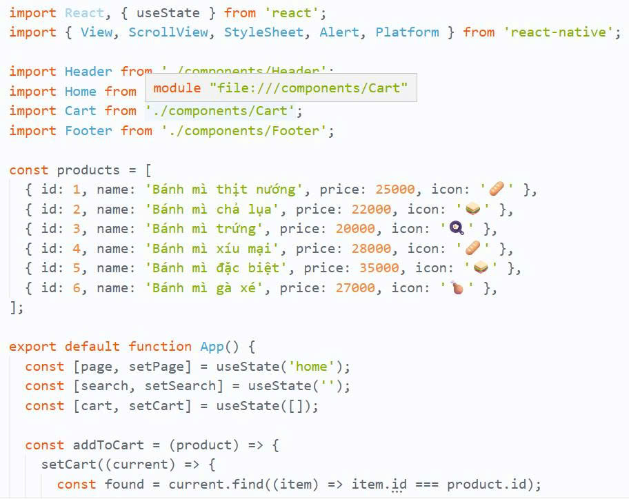
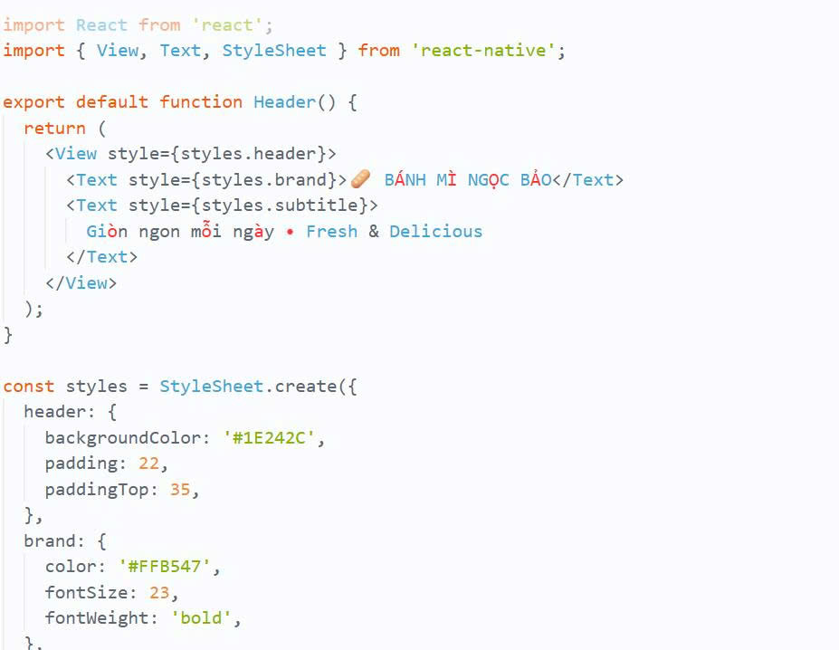
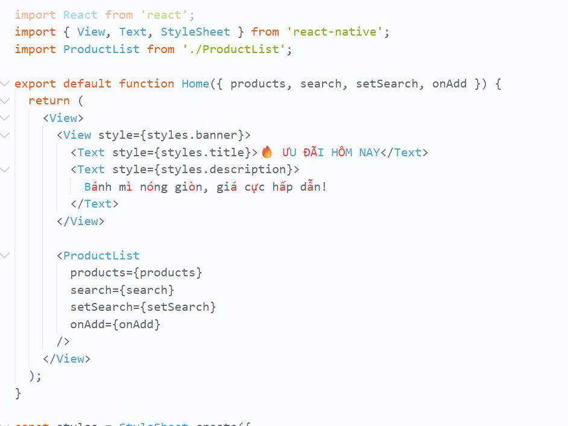
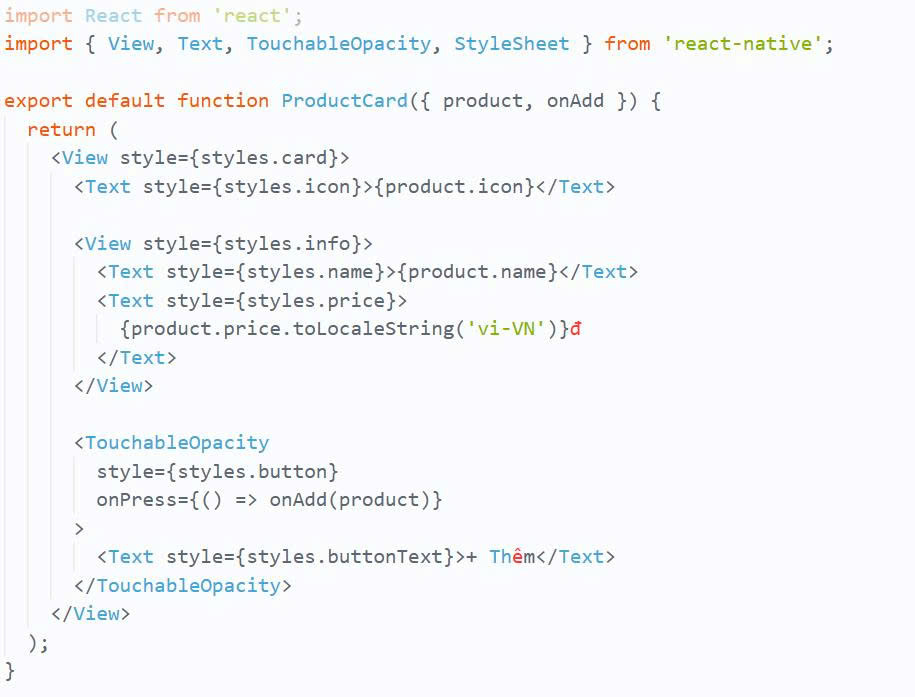
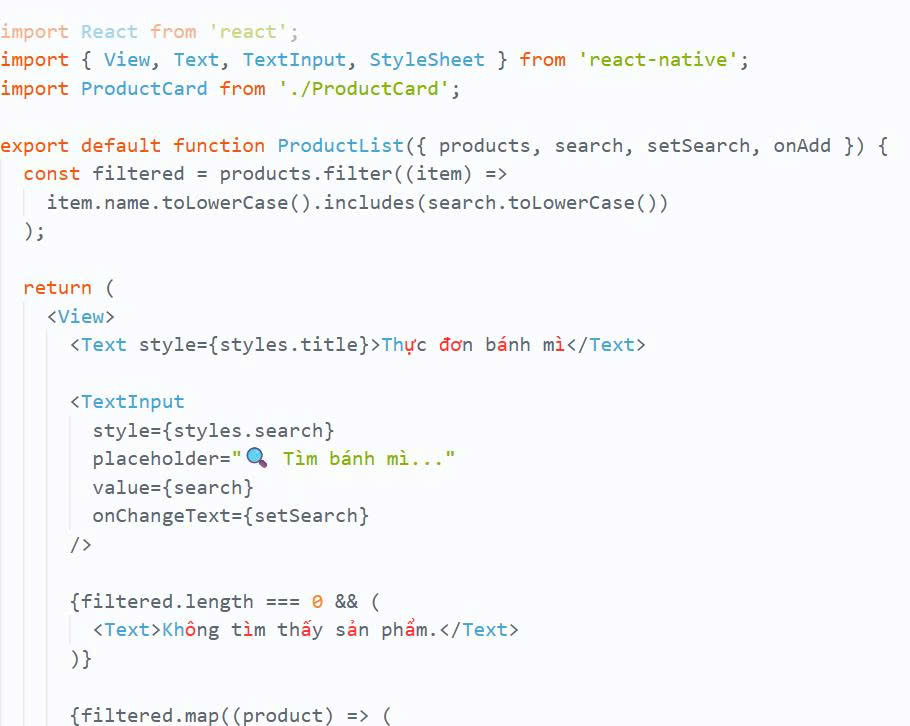
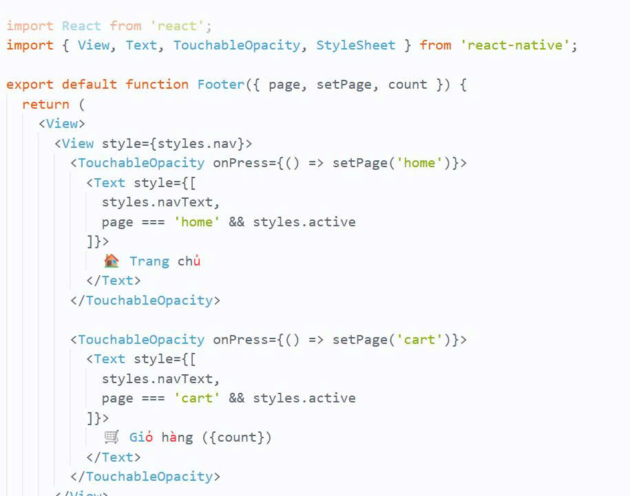

# BÀI 02 – BT01: ỨNG DỤNG BÁN BÁNH MÌ

## 1. Thông tin sinh viên
- Họ tên: Đỗ Trung Ngọc Bảo
- Mã sinh viên: CD-CNTT18A05
- Lớp: CD-CNTT18A
- Môn học: React Native

## 2. Thông tin ứng dụng
- Tên ứng dụng: MyApp_V2_BanhMiNgocBao
- Công nghệ: React Native
- Nền tảng: Expo Snack

## 3. Link ứng dụng Expo Snack
[Chạy ứng dụng Bánh Mì Ngọc Bảo](https://snack.expo.dev/@dotrungngocbao/myapp_v2_banhmingocbao)

## 4. Giới thiệu
Ứng dụng Bánh Mì Ngọc Bảo mô phỏng cửa hàng bán bánh mì với giao diện hiện đại, sử dụng các component riêng biệt.

## 5. Chức năng
- Hiển thị 6 loại bánh mì.
- Tìm kiếm sản phẩm.
- Thêm sản phẩm vào giỏ hàng.
- Tăng, giảm số lượng.
- Tự động tính tổng tiền.
- Xác nhận đặt hàng mô phỏng.
- Chuyển đổi giữa trang chủ và giỏ hàng.

## 6. Các component
- **App.js:** Quản lý trạng thái và kết nối các component.
- **Header.js:** Hiển thị tên cửa hàng.
- **Home.js:** Trang chủ và banner khuyến mãi.
- **ProductCard.js:** Hiển thị từng sản phẩm.
- **ProductList.js:** Danh sách và tìm kiếm sản phẩm.
- **Cart.js:** Giỏ hàng, số lượng và tổng tiền.
- **Footer.js:** Thanh điều hướng.

## 7. Thay đổi giao diện
- `backgroundColor`: Thay đổi màu nền.
- `fontSize`: Điều chỉnh kích thước chữ.
- `fontWeight`: Làm đậm tiêu đề.
- `borderRadius`: Bo tròn các thẻ sản phẩm.
- `padding`: Tạo khoảng cách.
- `flexDirection`: Sắp xếp các thành phần.

## 8. HÌNH ẢNH MINH CHỨNG

### 8.1. Trang chủ

### 8.2. Tìm kiếm

### 8.3. Giỏ hàng

### 8.4. Code App.js

### 8.5. Code Header.js

### 8.6. Code Home.js

### 8.7. Code ProductCard.js

### 8.8. Code ProductList.js

### 8.9. Code Footer.js

## 9. Kết quả
Ứng dụng được xây dựng bằng React Native trên Expo Snack, sử dụng các component riêng biệt và hỗ trợ các chức năng bán hàng mô phỏng.

**Sinh viên thực hiện: Đỗ Trung Ngọc Bảo – CD-CNTT18A05**
