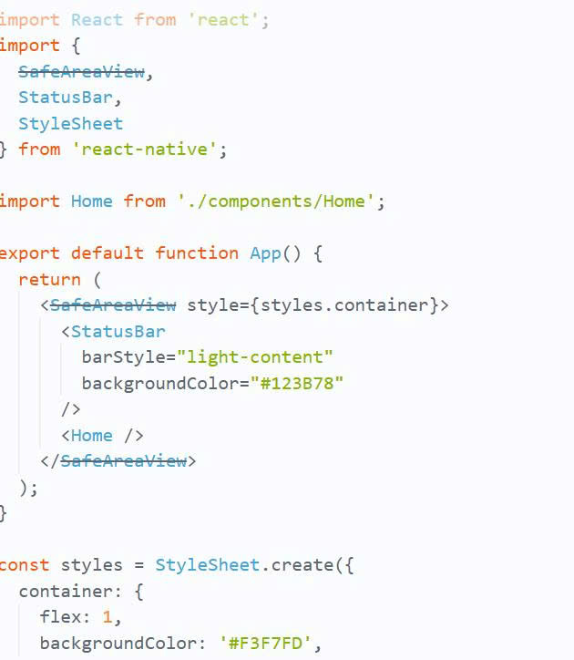
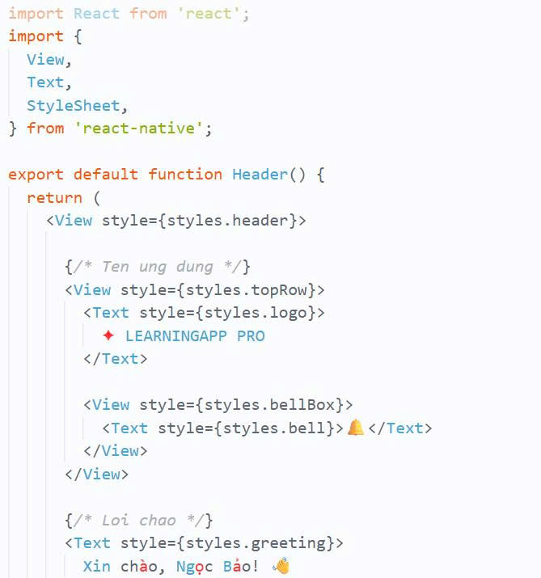
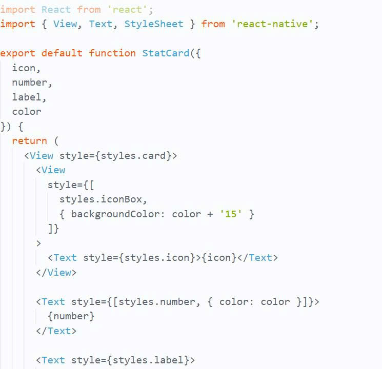
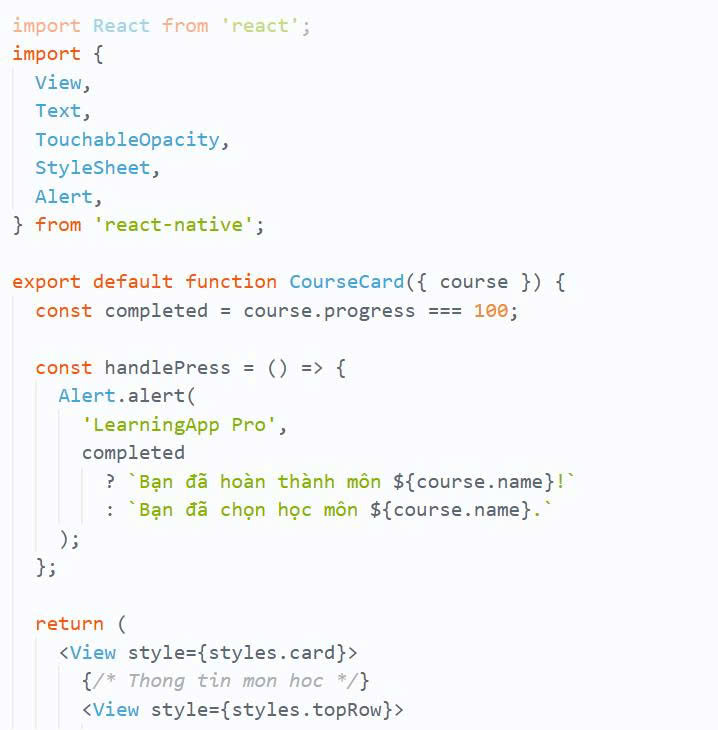
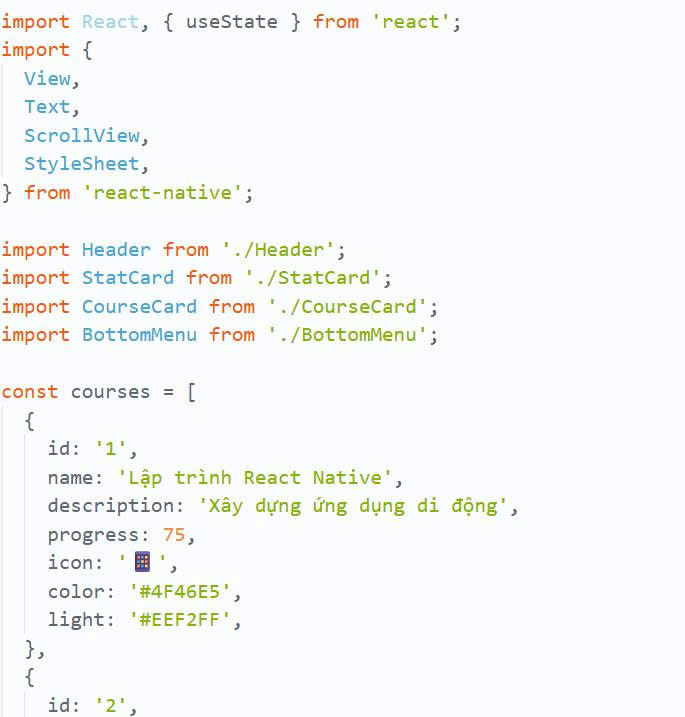
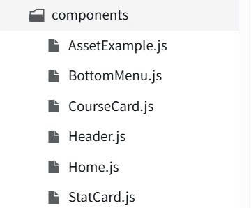

# 📚 LEARNINGAPP – ĐỖ TRUNG NGỌC BẢO

## 1. Thông tin sinh viên

- **Họ và tên:** Đỗ Trung Ngọc Bảo
- **Mã sinh viên:** CD-CNTT18A05
- **Lớp:** CD-CNTT18A
- **Bài tập:** BT02 – Thiết kế trang chủ ứng dụng học tập
- **Công nghệ:** React Native, Expo Snack
- **Tên ứng dụng:** LearningApp-DoTrungNgocBao

## 2. Giới thiệu ứng dụng

LearningApp là ứng dụng mô phỏng giao diện học tập dành cho sinh viên công nghệ thông tin, được xây dựng bằng React Native trên nền tảng Expo Snack.

Ứng dụng có giao diện xanh navy – tím, hiển thị thông tin sinh viên, thống kê học tập, danh sách khóa học và thanh menu điều hướng.

## 3. Các chức năng chính

- Hiển thị lời chào và thông tin sinh viên.
- Hiển thị tổng số khóa học, môn đang học và môn hoàn thành.
- Hiển thị danh sách 6 khóa học CNTT.
- Hiển thị thanh tiến độ học tập của từng môn.
- Có nút Học tiếp với thông báo mô phỏng.
- Có thanh menu Trang chủ – Khóa học – Cá nhân.
- Hiển thị trang hồ sơ sinh viên.

## 4. Cấu trúc component

```text
LearningApp/
├── App.js
└── components/
    ├── Header.js
    ├── StatCard.js
    ├── CourseCard.js
    ├── BottomMenu.js
    └── Home.js
```

**Chức năng từng component:**

- `Header.js`: Hiển thị lời chào và thông tin sinh viên.
- `StatCard.js`: Hiển thị các ô thống kê.
- `CourseCard.js`: Hiển thị môn học và tiến độ.
- `BottomMenu.js`: Thanh menu điều hướng mô phỏng.
- `Home.js`: Kết hợp các component thành ứng dụng hoàn chỉnh.
- `App.js`: Điểm bắt đầu của ứng dụng.

## 5. Link chạy ứng dụng Expo Snack

**Link Expo Snack:** CHUA_CAP_NHAT_LINK_EXPO

## 6. Hình ảnh minh chứng

### 6.1. Giao diện Trang chủ


### 6.2. Giao diện Khóa học


### 6.3. Giao diện Cá nhân


### 6.4. Code App.js



### 6.5. Component Header.js



### 6.6. Component StatCard.js



### 6.7. Component CourseCard.js



### 6.8. Component BottomMenu.js


### 6.9. Component Home.js



### 6.10. Cấu trúc thư mục components



## 7. Kết luận

Bài tập đã xây dựng giao diện ứng dụng học tập bằng React Native, sử dụng các component riêng biệt để dễ quản lý và tái sử dụng mã nguồn.

Ứng dụng được thực hiện và chạy thử trên Expo Snack.
