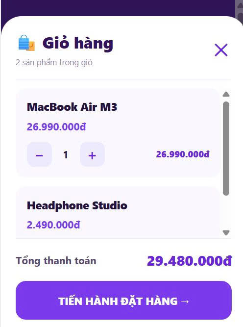

# BT03 – ProductApp Purple Tech Pro

## 1. Thông tin sinh viên

- **Họ và tên:** Đỗ Trung Ngọc Bảo
- **Mã sinh viên:** CD-CNTT18A05
- **Lớp:** CD-CNTT18A
- **Tên bài tập:** BT03 – ProductApp Purple Tech Pro
- **Công nghệ:** React Native – Expo Snack

## 2. Link chạy ứng dụng

**Expo Snack:**  
https://snack.expo.dev/@dotrungngocbao/productapp

Ứng dụng được xây dựng và chạy thử trực tiếp trên nền tảng Expo Snack.

## 3. Giới thiệu ứng dụng

ProductApp Purple Tech Pro là ứng dụng giới thiệu và bán các thiết bị công nghệ, được xây dựng bằng React Native.

Ứng dụng có giao diện màu tím chủ đạo, bố cục hiện đại, hỗ trợ hiển thị sản phẩm, tìm kiếm, lọc danh mục, quản lý giỏ hàng và đặt hàng.

Bài tập vận dụng kiến thức về React Native, Component, Props, State, FlatList, StyleSheet và xử lý sự kiện.

## 4. Danh sách sản phẩm

Ứng dụng gồm 8 sản phẩm công nghệ:

| STT | Tên sản phẩm | Giá bán |
|---|---|---|
| 1 | MacBook Air M3 | 26.990.000đ |
| 2 | Headphone Studio | 2.490.000đ |
| 3 | Smart Watch Pro | 3.990.000đ |
| 4 | Camera Creator | 12.990.000đ |
| 5 | Keyboard RGB | 1.490.000đ |
| 6 | Gaming Mouse X | 890.000đ |
| 7 | Smartphone Ultra | 19.990.000đ |
| 8 | Bluetooth Speaker | 1.790.000đ |

Mỗi sản phẩm được hiển thị với hình ảnh, tên, danh mục, mô tả, giá bán và nút thêm vào giỏ hàng.

## 5. Các chức năng chính

### 5.1. Hiển thị sản phẩm
- Hiển thị danh sách sản phẩm bằng FlatList.
- Sắp xếp sản phẩm thành 2 cột.
- Sử dụng ProductCard để tái sử dụng giao diện.
- Truyền thông tin sản phẩm thông qua Props.

### 5.2. Tìm kiếm và lọc sản phẩm
- Tìm kiếm sản phẩm theo tên hoặc mô tả.
- Lọc theo danh mục sản phẩm.
- Hiển thị thông báo khi không tìm thấy sản phẩm phù hợp.

### 5.3. Quản lý giỏ hàng
- Thêm sản phẩm vào giỏ hàng.
- Tăng hoặc giảm số lượng.
- Tự động cập nhật tổng số lượng.
- Tính tổng tiền sản phẩm.
- Xóa sản phẩm khỏi giỏ khi giảm số lượng về 0.

### 5.4. Đặt hàng
- Nhập họ tên người mua.
- Nhập số điện thoại.
- Nhập địa chỉ nhận hàng.
- Kiểm tra thông tin trước khi xác nhận.
- Hỗ trợ phương thức thanh toán khi nhận hàng (COD).

### 5.5. Lịch sử đơn hàng
- Hiển thị danh sách đơn hàng đã đặt.
- Hiển thị mã đơn hàng và thời gian đặt.
- Hiển thị thông tin người mua.
- Hiển thị các sản phẩm đã đặt.
- Hiển thị tổng tiền và trạng thái đơn hàng.

*Lưu ý: Phiên bản sử dụng State lưu đơn hàng tạm thời trong phiên chạy ứng dụng, chưa kết nối cơ sở dữ liệu.*

## 6. Cấu trúc thư mục

```text
Bai02/
└── Bt03/
    ├── App.js
    ├── Readme.md
    ├── components/
    │   ├── Header.js
    │   ├── ProductCard.js
    │   ├── ProductList.js
    │   ├── CartPanel.js
    │   ├── OrderHistory.js
    │   └── products.js
    └── images/
        ├── README.md
        ├── 01_TrangChu.png
        ├── 02_SanPham.png
        ├── 03_GioHang.png
        ├── 04_ThongTinNguoiMua.png
        └── 05_DonHang.png
```

## 7. Giải thích các Component

| File | Chức năng |
|---|---|
| App.js | Quản lý trạng thái, tìm kiếm, giỏ hàng và đơn hàng |
| Header.js | Hiển thị tên cửa hàng và biểu tượng giỏ hàng |
| ProductCard.js | Hiển thị thông tin từng sản phẩm, nhận Props |
| ProductList.js | Hiển thị danh sách sản phẩm bằng FlatList |
| CartPanel.js | Hiển thị giỏ hàng và biểu mẫu đặt hàng |
| OrderHistory.js | Hiển thị lịch sử và chi tiết đơn hàng |
| products.js | Chứa dữ liệu 8 sản phẩm |

## 8. Hình ảnh minh chứng

### 8.1. Giao diện trang chủ


### 8.2. Danh sách sản phẩm


### 8.3. Giỏ hàng



### 8.4. Thông tin người mua


### 8.5. Thông tin đơn hàng


## 9. Kiến thức đã áp dụng

- Tạo và tổ chức Component trong React Native.
- Sử dụng Props để truyền dữ liệu giữa các Component.
- Sử dụng useState để quản lý trạng thái.
- Hiển thị danh sách dữ liệu bằng FlatList.
- Sử dụng TextInput để nhập dữ liệu.
- Xử lý sự kiện với TouchableOpacity.
- Sử dụng StyleSheet để thiết kế giao diện.
- Sử dụng JavaScript để tìm kiếm, lọc và xử lý dữ liệu.

## 10. Kết luận

Qua bài tập BT03 – ProductApp Purple Tech Pro, em đã vận dụng kiến thức React Native để xây dựng ứng dụng bán hàng với các Component được tổ chức riêng biệt.

Ứng dụng thực hiện được các chức năng cơ bản như hiển thị danh sách sản phẩm, tìm kiếm, lọc danh mục, thêm sản phẩm vào giỏ hàng và quản lý đơn hàng.

Bài tập giúp em hiểu rõ hơn về cách sử dụng Component, Props, State, FlatList và xử lý sự kiện trong React Native.
