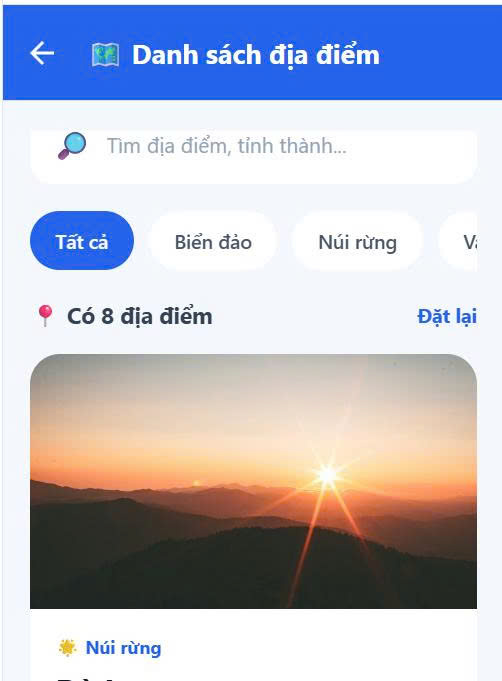

# 🌏 BT04 – MULTISCREENAPP
## ỨNG DỤNG KHÁM PHÁ DU LỊCH VIỆT NAM

**Bài tập 4: Xây dựng ứng dụng nhiều màn hình bằng React Native**

---

## 👨‍🎓 1. THÔNG TIN SINH VIÊN

| Thông tin | Nội dung |
|---|---|
| Họ và tên | **Đỗ Trung Ngọc Bảo** |
| Mã số sinh viên | **CD-CNTT18A05** |
| Lớp | **CD-CNTT18A** |
| Môn học | React Native |
| Bài học | Bài 2 – Xây dựng giao diện ứng dụng |
| Bài tập | BT04 – Xây dựng ứng dụng nhiều màn hình |
| Tên ứng dụng | **MultiScreenApp** |
| Chủ đề | Khám phá du lịch Việt Nam |
| Nền tảng | React Native – Expo Snack |
| Ngôn ngữ | JavaScript |

---

## 🔗 2. LINK CHẠY ỨNG DỤNG

### 🚀 Expo Snack

**[👉 NHẤN VÀO ĐÂY ĐỂ CHẠY MULTISCREENAPP](https://snack.expo.dev/@dotrungngocbao/multiscreenapp)**

Đường dẫn:

https://snack.expo.dev/@dotrungngocbao/multiscreenapp

Ứng dụng được phát triển trên Expo Snack, có thể xem và kiểm tra giao diện trực tiếp trên trình duyệt.

---

## 📖 3. GIỚI THIỆU ỨNG DỤNG

**MultiScreenApp – Khám phá du lịch Việt Nam** là ứng dụng giới thiệu các địa điểm du lịch nổi bật tại Việt Nam, được xây dựng bằng React Native.

Ứng dụng cung cấp giao diện hiện đại, dễ sử dụng, giúp người dùng khám phá danh sách địa điểm, tìm kiếm theo tên hoặc tỉnh thành, lọc theo danh mục và xem thông tin chi tiết của từng điểm đến.

Dự án sử dụng **Stack Navigation** để quản lý việc chuyển đổi giữa các màn hình.

### 🎯 Mục tiêu

- Làm quen với cách xây dựng ứng dụng React Native nhiều màn hình.
- Sử dụng Stack Navigation để điều hướng.
- Thiết kế các màn hình HomeScreen, ListScreen và DetailScreen.
- Tổ chức giao diện bằng component tái sử dụng.
- Truyền dữ liệu giữa các màn hình bằng `route.params`.
- Sử dụng React Hooks để quản lý trạng thái.
- Xây dựng chức năng tìm kiếm và lọc danh sách.
- Hoàn thiện ứng dụng để chạy trên Expo Snack.

---

## 🧩 4. CÁC CHỨC NĂNG CHÍNH

| STT | Chức năng | Mô tả |
|---|---|---|
| 1 | Trang chủ | Hiển thị giới thiệu ứng dụng và thông tin sinh viên |
| 2 | Xem danh sách | Hiển thị 8 địa điểm du lịch |
| 3 | Tìm kiếm | Tìm địa điểm theo tên hoặc tỉnh thành |
| 4 | Lọc danh mục | Lọc theo Biển đảo, Núi rừng và Văn hóa |
| 5 | Xem chi tiết | Hiển thị thông tin địa điểm được chọn |
| 6 | Quay lại | Quay về màn hình danh sách |
| 7 | Thống kê | Hiển thị số lượng địa điểm sau khi lọc |
| 8 | Đặt lại bộ lọc | Xóa từ khóa tìm kiếm và chọn lại tất cả |
| 9 | Component tái sử dụng | Sử dụng DestinationCard để hiển thị các địa điểm |

---

## 🗂️ 5. CẤU TRÚC DỰ ÁN

```text
MultiScreenApp/
│
├── App.js
├── package.json
├── Readme.md
│
├── screens/
│   ├── HomeScreen.js
│   ├── ListScreen.js
│   └── DetailScreen.js
│
├── components/
│   └── DestinationCard.js
│
└── images/
    ├── 01_HomeScreen.png
    ├── 02_ListScreen.png
    ├── 03_DetailScreen.png
    ├── 04_TimKiem.png
    └── 05_LocDanhMuc.png
```

### Vai trò các file

| File | Chức năng |
|---|---|
| `App.js` | Khai báo Stack Navigation và các màn hình |
| `HomeScreen.js` | Xây dựng giao diện trang chủ |
| `ListScreen.js` | Danh sách, tìm kiếm và lọc địa điểm |
| `DetailScreen.js` | Hiển thị thông tin chi tiết địa điểm |
| `DestinationCard.js` | Component thẻ địa điểm tái sử dụng |
| `package.json` | Khai báo thư viện sử dụng |
| `Readme.md` | Tài liệu giới thiệu và hướng dẫn |
| `images/` | Lưu ảnh chụp giao diện ứng dụng |

---

## 📱 6. THIẾT KẾ CÁC MÀN HÌNH

### 🏠 6.1. HomeScreen – Trang chủ

**Chức năng:**

- Hiển thị lời chào và tên sinh viên.
- Hiển thị banner giới thiệu du lịch Việt Nam.
- Hiển thị các thông tin thống kê.
- Giới thiệu chức năng của ứng dụng.
- Có nút **Khám phá ngay** để chuyển đến ListScreen.

**Hình ảnh giao diện:**


**Ví dụ code chuyển màn hình:**

```jsx
<TouchableOpacity
  onPress={() => navigation.navigate('List')}
>
  <Text>Khám phá ngay →</Text>
</TouchableOpacity>
```

**Kết quả:** Khi nhấn nút Khám phá ngay, ứng dụng chuyển sang màn hình danh sách địa điểm.

---

### 🗺️ 6.2. ListScreen – Danh sách địa điểm

**Chức năng:**

- Hiển thị danh sách 8 địa điểm.
- Hiển thị hình ảnh, tên, vị trí và mô tả.
- Tìm kiếm địa điểm.
- Lọc theo danh mục.
- Hiển thị số lượng kết quả.
- Chọn địa điểm để chuyển sang DetailScreen.

**Hình ảnh giao diện:**



**Ví dụ code tìm kiếm và lọc:**

```jsx
const [search, setSearch] = useState('');
const [category, setCategory] = useState('Tất cả');

const filtered = destinations.filter((item) => {
  const keyword = search.trim().toLowerCase();

  const matchSearch =
    item.name.toLowerCase().includes(keyword) ||
    item.location.toLowerCase().includes(keyword);

  const matchCategory =
    category === 'Tất cả' ||
    item.category === category;

  return matchSearch && matchCategory;
});
```

**Ví dụ sử dụng component DestinationCard:**

```jsx
{filtered.map((item) => (
  <DestinationCard
    key={item.id}
    item={item}
    onPress={() =>
      navigation.navigate('Detail', {
        destination: item,
      })
    }
  />
))}
```

---

### 📍 6.3. DetailScreen – Chi tiết địa điểm

**Chức năng:**

- Nhận thông tin địa điểm được chọn.
- Hiển thị ảnh đại diện.
- Hiển thị tên địa điểm.
- Hiển thị tỉnh thành và danh mục.
- Hiển thị phần giới thiệu.
- Hiển thị thông tin chuyến đi.
- Có nút quay lại màn hình danh sách.

**Hình ảnh giao diện:**


**Ví dụ nhận dữ liệu:**

```jsx
export default function DetailScreen({
  navigation,
  route,
}) {
  const destination = route.params?.destination;

  // Hiển thị thông tin destination
}
```

**Ví dụ nút quay lại:**

```jsx
<TouchableOpacity
  onPress={() => navigation.goBack()}
>
  <Text>← Quay lại danh sách</Text>
</TouchableOpacity>
```

---

## 🧱 7. COMPONENT DESTINATIONCARD

Ứng dụng sử dụng component `DestinationCard` để hiển thị từng địa điểm trong danh sách.

### Vai trò

Component nhận hai props:

- `item`: dữ liệu địa điểm.
- `onPress`: hàm xử lý khi người dùng chọn địa điểm.

**Code minh họa:**

```jsx
import React from 'react';
import {
  View,
  Text,
  Image,
  TouchableOpacity,
} from 'react-native';

export default function DestinationCard({
  item,
  onPress,
}) {
  return (
    <TouchableOpacity onPress={onPress}>
      <Image
        source={{ uri: item.image }}
        style={{ width: '100%', height: 170 }}
      />

      <View>
        <Text>{item.category}</Text>
        <Text>{item.name}</Text>
        <Text>📍 {item.location}</Text>
        <Text>{item.description}</Text>
        <Text>Xem chi tiết →</Text>
      </View>
    </TouchableOpacity>
  );
}
```

*Đây là đoạn code minh họa rút gọn. File `components/DestinationCard.js` chứa phần giao diện và StyleSheet đầy đủ.*

### Ưu điểm

- Tránh lặp lại code.
- Dễ quản lý giao diện.
- Dễ bảo trì và mở rộng.
- Có thể tái sử dụng ở nhiều màn hình.

---

## 🔀 8. STACK NAVIGATION

Ứng dụng sử dụng React Navigation để điều hướng giữa 3 màn hình.

### Sơ đồ điều hướng

```text
           App.js
              │
      NavigationContainer
              │
        Stack Navigator
              │
       ┌──────┴──────┐
       │             │
   HomeScreen        │
       │             │
       ▼             │
   ListScreen ◄──────┤
       │             │
       ▼             │
  DetailScreen       │
       │             │
       └── Quay lại ─┘
```

### Code minh họa trong App.js

```jsx
import React from 'react';
import { NavigationContainer } from
  '@react-navigation/native';
import { createNativeStackNavigator } from
  '@react-navigation/native-stack';

import HomeScreen from './screens/HomeScreen';
import ListScreen from './screens/ListScreen';
import DetailScreen from './screens/DetailScreen';

const Stack = createNativeStackNavigator();

export default function App() {
  return (
    <NavigationContainer>
      <Stack.Navigator
        initialRouteName="Home"
        screenOptions={{
          headerStyle: {
            backgroundColor: '#2563EB',
          },
          headerTintColor: '#FFFFFF',
        }}
      >
        <Stack.Screen
          name="Home"
          component={HomeScreen}
          options={{
            title: '🌏 MultiScreenApp',
          }}
        />

        <Stack.Screen
          name="List"
          component={ListScreen}
          options={{
            title: '🗺️ Danh sách địa điểm',
          }}
        />

        <Stack.Screen
          name="Detail"
          component={DetailScreen}
          options={{
            title: '📍 Chi tiết địa điểm',
          }}
        />
      </Stack.Navigator>
    </NavigationContainer>
  );
}
```

### Luồng hoạt động

1. Mở ứng dụng → HomeScreen.
2. Nhấn Khám phá ngay → ListScreen.
3. Chọn một địa điểm → DetailScreen.
4. Nhấn Quay lại danh sách → ListScreen.

---

## 🌄 9. DANH SÁCH ĐỊA ĐIỂM DU LỊCH

Ứng dụng giới thiệu 8 địa điểm:

| STT | Địa điểm | Tỉnh/Thành | Danh mục |
|---|---|---|---|
| 1 | Đà Lạt | Lâm Đồng | Núi rừng |
| 2 | Nha Trang | Khánh Hòa | Biển đảo |
| 3 | Hội An | Đà Nẵng | Văn hóa |
| 4 | Phú Quốc | An Giang | Biển đảo |
| 5 | Sa Pa | Lào Cai | Núi rừng |
| 6 | Huế | Huế | Văn hóa |
| 7 | Hạ Long | Quảng Ninh | Biển đảo |
| 8 | Mộc Châu | Sơn La | Núi rừng |

Dữ liệu được khai báo trong mảng JavaScript để phục vụ việc hiển thị, tìm kiếm, lọc và truyền dữ liệu giữa các màn hình.

---

## 🔎 10. CHỨC NĂNG TÌM KIẾM

Người dùng nhập tên địa điểm hoặc tỉnh thành vào thanh tìm kiếm.

**Ví dụ:** Nhập `Nha Trang` để hiển thị địa điểm tương ứng.

**Ảnh minh họa:**


**Đoạn code:**

```jsx
<TextInput
  placeholder="Tìm địa điểm, tỉnh thành..."
  value={search}
  onChangeText={setSearch}
/>
```

Chức năng tìm kiếm sử dụng `useState` để cập nhật kết quả khi người dùng nhập dữ liệu.

---

## 🏷️ 11. CHỨC NĂNG LỌC DANH MỤC

Các danh mục được hỗ trợ:

- Tất cả
- Biển đảo
- Núi rừng
- Văn hóa

**Ảnh minh họa:**


**Đoạn code:**

```jsx
const categories = [
  'Tất cả',
  'Biển đảo',
  'Núi rừng',
  'Văn hóa',
];
```

Khi chọn một danh mục, ứng dụng chỉ hiển thị những địa điểm phù hợp.

Người dùng có thể chọn **Đặt lại** để hiển thị toàn bộ danh sách.

---

## 🎨 12. THIẾT KẾ GIAO DIỆN

Ứng dụng sử dụng phong cách hiện đại, đơn giản và dễ sử dụng.

### Màu sắc chính

| Màu | Mã màu | Công dụng |
|---|---|---|
| Xanh dương | `#2563EB` | Header, nút và điểm nhấn |
| Trắng | `#FFFFFF` | Thẻ nội dung |
| Xanh đen | `#0F172A` | Tiêu đề |
| Xám xanh | `#64748B` | Nội dung phụ |
| Xám nhạt | `#F4F7FC` | Nền ứng dụng |

### Thành phần giao diện

- View
- Text
- Image
- TextInput
- ScrollView
- TouchableOpacity
- StyleSheet

Ứng dụng sử dụng thẻ bo góc, hình ảnh minh họa và các nút tương tác.

---

## ⚙️ 13. CÔNG NGHỆ SỬ DỤNG

| Công nghệ | Mục đích |
|---|---|
| React Native | Xây dựng giao diện ứng dụng |
| Expo Snack | Viết code và chạy thử |
| JavaScript | Ngôn ngữ lập trình |
| React Hooks | Quản lý trạng thái |
| React Navigation | Điều hướng giữa các màn hình |
| Native Stack Navigator | Quản lý ngăn xếp màn hình |
| StyleSheet | Thiết kế giao diện |

### Các thư viện điều hướng

```text
@react-navigation/native
@react-navigation/native-stack
react-native-screens
react-native-safe-area-context
```

---

## ▶️ 14. HƯỚNG DẪN CHẠY ỨNG DỤNG

### Cách 1: Chạy trực tiếp trên Expo Snack

**Bước 1:** Mở đường dẫn:

https://snack.expo.dev/@dotrungngocbao/multiscreenapp

**Bước 2:** Chờ Expo Snack tải mã nguồn.

**Bước 3:** Chọn môi trường Preview phù hợp.

**Bước 4:** Kiểm tra các màn hình:

- HomeScreen
- ListScreen
- DetailScreen

**Bước 5:** Thử tìm kiếm, lọc danh mục, xem chi tiết và quay lại.

### Cách 2: Xem mã nguồn trên GitHub

Mở thư mục `Bai02/Bt04` trong repository chứa bài nộp.

Các file JavaScript và `package.json` được lưu trong thư mục này để phục vụ việc kiểm tra mã nguồn.

---

## 🧪 15. CÁC TRƯỜNG HỢP KIỂM TRA

| STT | Thao tác kiểm tra | Kết quả mong đợi |
|---|---|---|
| 1 | Mở ứng dụng | Hiển thị HomeScreen |
| 2 | Nhấn Khám phá ngay | Chuyển đến ListScreen |
| 3 | Chọn Tất cả | Hiển thị 8 địa điểm |
| 4 | Nhập Nha Trang | Hiển thị 1 kết quả |
| 5 | Chọn Biển đảo | Hiển thị các địa điểm biển đảo |
| 6 | Chọn Đà Lạt | Mở DetailScreen của Đà Lạt |
| 7 | Nhấn Quay lại | Trở về ListScreen |
| 8 | Nhập từ khóa không tồn tại | Hiển thị thông báo không tìm thấy |
| 9 | Nhấn Đặt lại | Xóa tìm kiếm và bộ lọc |

---

## 📋 16. ĐỐI CHIẾU YÊU CẦU BÀI TẬP

| Yêu cầu BT04 | Phần thực hiện |
|---|---|
| Xây dựng HomeScreen | `screens/HomeScreen.js` |
| Xây dựng ListScreen | `screens/ListScreen.js` |
| Xây dựng DetailScreen | `screens/DetailScreen.js` |
| Chọn mục để xem chi tiết | `navigation.navigate('Detail', ...)` |
| Có nút quay lại | `navigation.goBack()` |
| Sử dụng Stack Navigation | `App.js` |
| Tổ chức component | `components/DestinationCard.js` |
| Có link ứng dụng Expo | Mục 2 |
| Có code minh họa | Mục 6–8, 10–11 |
| Có ảnh chụp giao diện | Mục 6, 10, 11 |

---

## 🚀 17. HƯỚNG PHÁT TRIỂN

Trong tương lai, ứng dụng có thể bổ sung:

- Lưu địa điểm yêu thích.
- Hiển thị bản đồ du lịch.
- Đánh giá và bình luận địa điểm.
- Kết nối API để cập nhật dữ liệu.
- Thêm nhiều địa điểm du lịch.
- Tạo màn hình thông tin cá nhân.
- Bổ sung Tab Navigation.

Đây là những tính năng định hướng phát triển, chưa phải toàn bộ chức năng hiện có của ứng dụng.

---

## ✅ 18. KẾT LUẬN

Qua bài tập **BT04 – MultiScreenApp**, em đã thực hành xây dựng ứng dụng React Native gồm nhiều màn hình và tổ chức mã nguồn thành các component riêng biệt.

Ứng dụng sử dụng Stack Navigation để chuyển đổi giữa HomeScreen, ListScreen và DetailScreen. Đồng thời, em đã áp dụng React Hooks để thực hiện chức năng tìm kiếm và lọc danh sách địa điểm.

Bài tập giúp em hiểu rõ hơn về cách tổ chức dự án React Native, thiết kế giao diện, truyền dữ liệu giữa các màn hình và xử lý sự kiện tương tác.

---

**👨‍💻 Sinh viên thực hiện: Đỗ Trung Ngọc Bảo**

**🆔 MSSV: CD-CNTT18A05**

**🏫 Lớp: CD-CNTT18A**

**🌏 Ứng dụng: MultiScreenApp – Khám phá du lịch Việt Nam**

**🔗 Expo Snack: https://snack.expo.dev/@dotrungngocbao/multiscreenapp**
