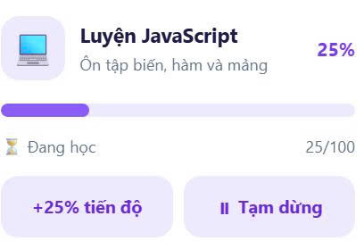
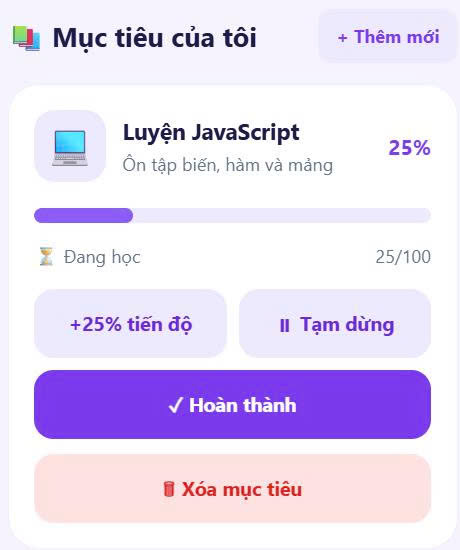
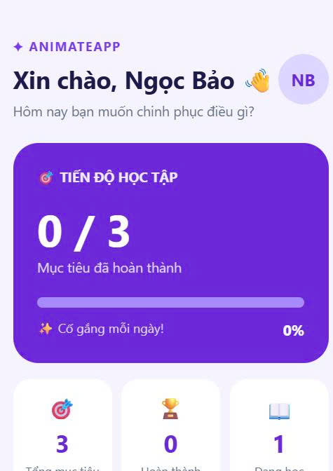
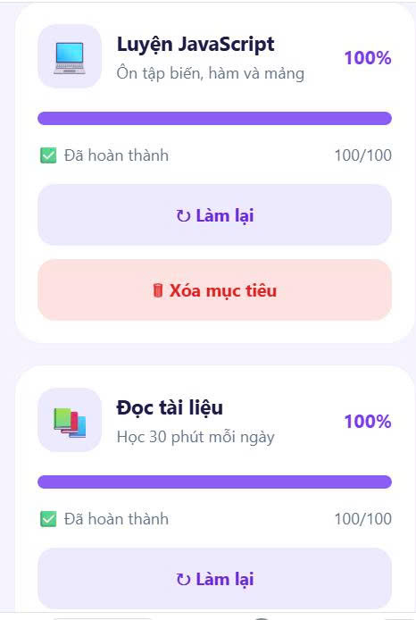

# BÀI TẬP 5 – ANIMATEAPP
## Thiết kế giao diện có hiệu ứng động bằng React Native

### 1. Thông tin sinh viên

- **Họ và tên:** Đỗ Trung Ngọc Bảo
- **Mã sinh viên:** CD-CNTT18A05
- **Lớp:** CD-CNTT18A
- **Môn học:** React Native
- **Bài học:** Bài 2 – Xây dựng giao diện ứng dụng với React Native
- **Bài tập:** BT05 – Thiết kế giao diện có hiệu ứng động
- **Tên ứng dụng:** AnimateApp

### 2. Link ứng dụng Expo Snack

**Link chạy ứng dụng:**

https://snack.expo.dev/@dotrungngocbao/animateapp

**[NHẤN VÀO ĐÂY ĐỂ MỞ ỨNG DỤNG ANIMATEAPP](https://snack.expo.dev/@dotrungngocbao/animateapp)**

Ứng dụng được xây dựng và chạy trực tiếp trên Expo Snack. Có thể xem giao diện bằng Android, iOS hoặc Web Preview.

### 3. Giới thiệu ứng dụng

AnimateApp là ứng dụng quản lý và theo dõi mục tiêu học tập cá nhân được xây dựng bằng React Native.

Ứng dụng giúp người dùng tạo mục tiêu, theo dõi tiến độ, quản lý các công việc học tập và nhận thông báo chúc mừng khi hoàn thành.

Giao diện được thiết kế theo phong cách hiện đại với màu tím và trắng, các thẻ bo góc, thanh tiến độ và hiệu ứng động.

### 4. Các chức năng chính

1. Hiển thị danh sách mục tiêu học tập.
2. Bắt đầu thực hiện mục tiêu.
3. Tăng tiến độ mỗi lần 25%.
4. Tạm dừng và tiếp tục mục tiêu.
5. Hoàn thành mục tiêu và cập nhật 100%.
6. Hiển thị thông báo chúc mừng có hiệu ứng động.
7. Thêm mục tiêu học tập mới.
8. Tìm kiếm mục tiêu theo tên hoặc mô tả.
9. Lọc mục tiêu theo trạng thái.
10. Xóa mục tiêu có xác nhận.
11. Đặt lại tiến độ của từng mục tiêu.
12. Đặt lại toàn bộ tiến độ.
13. Thống kê tổng số mục tiêu, số hoàn thành và số đang học.
14. Lưu dữ liệu bằng AsyncStorage.

### 5. Cấu trúc thư mục

```text
Bai02/
└── Bt05/
    ├── App.js
    ├── package.json
    ├── Readme.md
    ├── components/
    │   ├── ProgressCard.js
    │   ├── ActionButton.js
    │   └── AnimatedMessage.js
    └── images/
        ├── 01_GiaoDien.png
        ├── 02_ProgressCard.png
        ├── 03_ActionButton.png
        ├── 04_AnimatedMessage.png
        └── 05_HoanThanh.png
```

### 6. Các component và hiệu ứng động

#### 6.1. ProgressCard.js – Thẻ tiến độ

Component `ProgressCard` hiển thị thông tin mục tiêu học tập, phần trăm hoàn thành và thanh tiến độ.

Sử dụng `Animated.timing()` để thay đổi chiều rộng thanh tiến độ với hiệu ứng chuyển động.

```jsx
Animated.timing(progress, {
  toValue: goal.progress,
  duration: 650,
  useNativeDriver: false,
}).start();
```

**Ảnh minh họa ProgressCard:**



#### 6.2. ActionButton.js – Nút hành động

Component `ActionButton` được sử dụng để tạo các nút bắt đầu, tạm dừng, tiếp tục và hoàn thành.

Khi nhấn nút, sử dụng `Animated.spring()` để tạo hiệu ứng thu nhỏ và trở lại kích thước ban đầu.

```jsx
Animated.spring(scale, {
  toValue: value,
  friction: 5,
  tension: 120,
  useNativeDriver: true,
}).start();
```

**Ảnh minh họa ActionButton:**



#### 6.3. AnimatedMessage.js – Thông báo động

Component `AnimatedMessage` hiển thị thông báo khi người dùng hoàn thành mục tiêu.

Các hiệu ứng được sử dụng:

- `opacity`: Thay đổi độ trong suốt.
- `scale`: Phóng to thông báo.
- `translateY`: Di chuyển thông báo từ dưới lên.

```jsx
Animated.parallel([
  Animated.timing(opacity, {
    toValue: 1,
    duration: 400,
    useNativeDriver: true,
  }),
  Animated.spring(scale, {
    toValue: 1,
    friction: 5,
    useNativeDriver: true,
  }),
  Animated.timing(moveY, {
    toValue: 0,
    duration: 450,
    useNativeDriver: true,
  }),
]).start();
```

**Ảnh minh họa AnimatedMessage:**


### 7. Hình ảnh giao diện ứng dụng

#### 7.1. Giao diện chính

Hiển thị lời chào, bảng tiến độ tổng, các thẻ thống kê và danh sách mục tiêu.



#### 7.2. Giao diện thanh tiến độ

Khi nhấn Bắt đầu học và tăng tiến độ, thanh tiến độ chuyển động theo giá trị mới.


#### 7.3. Giao diện nút hành động

Các nút Bắt đầu, Tạm dừng, Tiếp tục và Hoàn thành được thiết kế với hiệu ứng khi nhấn.


#### 7.4. Giao diện thông báo hoàn thành

Khi hoàn thành mục tiêu, thông báo chúc mừng xuất hiện với hiệu ứng phóng to và di chuyển.


#### 7.5. Giao diện hoàn thành tất cả mục tiêu

Khi hoàn thành toàn bộ mục tiêu, bảng thống kê hiển thị 100% và xuất hiện lời chúc mừng.



### 8. Quản lý trạng thái và lưu dữ liệu

Ứng dụng sử dụng React Hooks để quản lý các mục tiêu học tập.

```jsx
const [goals, setGoals] = useState(initialGoals);
const [search, setSearch] = useState('');
const [filter, setFilter] = useState('all');
```

Sử dụng AsyncStorage để lưu danh sách mục tiêu.

```jsx
AsyncStorage.setItem(
  STORAGE_KEY,
  JSON.stringify(goals)
);
```

### 9. Công nghệ sử dụng

- React Native
- Expo Snack
- JavaScript
- React Hooks
- React Native Animated API
- AsyncStorage
- StyleSheet
- Pressable
- ScrollView

### 10. Hướng dẫn chạy ứng dụng

**Bước 1:** Truy cập Expo Snack:

https://snack.expo.dev/@dotrungngocbao/animateapp

**Bước 2:** Chọn Android, iOS hoặc Web Preview.

**Bước 3:** Chờ giao diện AnimateApp hiển thị.

**Bước 4:** Nhấn Bắt đầu học để chuyển trạng thái.

**Bước 5:** Nhấn +25% tiến độ để quan sát hiệu ứng.

**Bước 6:** Nhấn Hoàn thành để xem thông báo động.

**Bước 7:** Thử các chức năng thêm, tìm kiếm, lọc, xóa và đặt lại mục tiêu.

### 11. Đối chiếu yêu cầu bài tập

| Yêu cầu bài tập | Nội dung thực hiện |
|---|---|
| Ứng dụng theo dõi mục tiêu học tập | AnimateApp |
| Có thẻ tiến độ | ProgressCard |
| Có nút bắt đầu | ActionButton |
| Có thông báo hoàn thành | AnimatedMessage |
| Có hiệu ứng khi nhấn nút | Animated.spring |
| Có hiệu ứng phóng to hoặc di chuyển | AnimatedMessage |
| Tách thành 3 component | Thư mục components |
| Có code minh họa | Mục 6 và 8 |
| Có ảnh minh họa giao diện | Mục 7 |
| Có link Expo | Mục 2 và 10 |

### 12. Kết luận

Qua bài thực hành BT05, em đã xây dựng ứng dụng theo dõi mục tiêu học tập bằng React Native với các chức năng quản lý tiến độ và hiệu ứng động.

Bài tập giúp em hiểu cách xây dựng component, quản lý trạng thái bằng React Hooks và sử dụng Animated API để tạo hiệu ứng cho giao diện.

**Sinh viên thực hiện: Đỗ Trung Ngọc Bảo**

**MSSV: CD-CNTT18A05**

**Lớp: CD-CNTT18A**

**Link ứng dụng:** https://snack.expo.dev/@dotrungngocbao/animateapp
