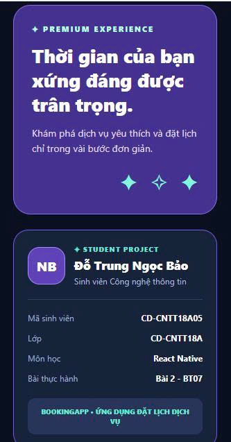
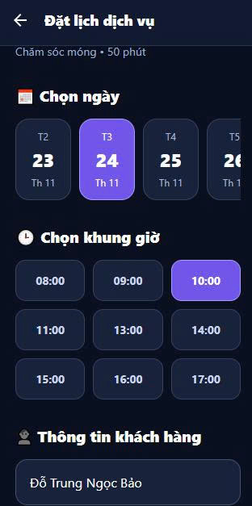
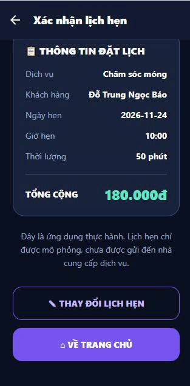

# 📱 BT07 – BOOKINGAPP
## ỨNG DỤNG ĐẶT LỊCH DỊCH VỤ BẰNG REACT NATIVE

### 1. Thông tin sinh viên

| Thông tin | Nội dung |
|---|---|
| Họ và tên | Đỗ Trung Ngọc Bảo |
| Mã sinh viên | CD-CNTT18A05 |
| Lớp | CD-CNTT18A |
| Môn học | Lập trình ứng dụng với React Native |
| Bài học | Bài 2 – Xây dựng giao diện ứng dụng với React Native |
| Bài tập | BT07 – Ứng dụng đặt lịch dịch vụ |
| Tên ứng dụng | BookingApp |
| Nền tảng | React Native – Expo Snack |

---

### 2. Link chạy ứng dụng

**Expo Snack:**

https://snack.expo.dev/@dotrungngocbao/bookingapp

Ứng dụng được xây dựng và chạy thử trực tiếp trên Expo Snack.

**Cách chạy:**
1. Truy cập liên kết Expo Snack.
2. Chờ dự án tải hoàn tất.
3. Chọn chế độ Android, iOS hoặc Web Preview được hỗ trợ.
4. Thao tác trên giao diện để trải nghiệm quy trình đặt lịch.

---

### 3. Giới thiệu ứng dụng

**BookingApp** là ứng dụng mô phỏng quy trình đặt lịch sử dụng dịch vụ, được phát triển bằng React Native.

Ứng dụng cho phép người dùng xem danh sách dịch vụ, tìm hiểu thông tin chi tiết, lựa chọn ngày giờ phù hợp, nhập tên khách hàng và xác nhận lịch hẹn.

Giao diện được thiết kế theo phong cách **Dark Premium**, sử dụng nền xanh đen kết hợp màu tím và xanh mint.

Trang chủ có khu vực giới thiệu ứng dụng và hiển thị thông tin sinh viên thực hiện.

**Mục tiêu bài thực hành:**
- Xây dựng ứng dụng React Native có nhiều màn hình.
- Biết tổ chức và tái sử dụng component.
- Sử dụng Stack Navigation để điều hướng.
- Sử dụng props để truyền dữ liệu.
- Sử dụng useState để quản lý trạng thái.
- Sử dụng TextInput để nhập dữ liệu.
- Xây dựng giao diện thân thiện và dễ sử dụng.

**Lưu ý:** Đây là ứng dụng đặt lịch giả lập phục vụ học tập, chưa kết nối cơ sở dữ liệu hoặc hệ thống thanh toán thực tế.

---

### 4. Các chức năng chính

**4.1. Trang chủ**

- Hiển thị tên ứng dụng BookingApp.
- Hiển thị banner giới thiệu.
- Hiển thị thông tin sinh viên.
- Hiển thị danh sách dịch vụ.
- Mỗi dịch vụ có hình ảnh, tên, thời lượng và giá.
- Cho phép chọn dịch vụ để xem chi tiết.

**4.2. Xem chi tiết dịch vụ**

- Hiển thị hình ảnh dịch vụ.
- Hiển thị tên và mô tả dịch vụ.
- Hiển thị thời lượng thực hiện.
- Hiển thị giá dịch vụ.
- Có nút chuyển sang màn hình đặt lịch.

**4.3. Đặt lịch dịch vụ**

- Hiển thị dịch vụ đã chọn.
- Cho phép lựa chọn ngày hẹn.
- Cho phép lựa chọn khung giờ.
- Nhập họ tên khách hàng.
- Hiển thị thông tin tóm tắt lịch hẹn.
- Kiểm tra thông tin trước khi xác nhận.
- Cho phép quay lại để chỉnh sửa lựa chọn.

**4.4. Xác nhận lịch hẹn**

- Hiển thị thông báo đặt lịch thành công.
- Hiển thị tên khách hàng.
- Hiển thị dịch vụ đã đặt.
- Hiển thị ngày và giờ hẹn.
- Hiển thị thời lượng và giá dịch vụ.
- Hiển thị mã đặt lịch giả lập.
- Cho phép quay về trang chủ.

---

### 5. Cấu trúc thư mục dự án

```text
BookingApp/
│
├── App.js
├── package.json
│
├── components/
│   ├── ServiceCard.js
│   ├── DateSelector.js
│   ├── TimeSlot.js
│   └── BookingSummary.js
│
├── data/
│   └── services.js
│
└── screens/
    ├── HomeScreen.js
    ├── ServiceDetailScreen.js
    ├── BookingScreen.js
    └── ConfirmationScreen.js
```

**Giải thích:**

- `App.js`: Cấu hình ứng dụng và điều hướng giữa các màn hình.
- `package.json`: Khai báo thư viện sử dụng.
- `components/`: Chứa các thành phần giao diện tái sử dụng.
- `data/services.js`: Chứa dữ liệu danh sách dịch vụ.
- `screens/`: Chứa các màn hình chính của ứng dụng.

---

### 6. Các màn hình của ứng dụng

| Màn hình | Chức năng |
|---|---|
| HomeScreen | Trang chủ, banner, thông tin sinh viên và danh sách dịch vụ |
| ServiceDetailScreen | Hiển thị thông tin chi tiết dịch vụ |
| BookingScreen | Chọn ngày, giờ và nhập thông tin đặt lịch |
| ConfirmationScreen | Hiển thị kết quả xác nhận đặt lịch |

**Luồng hoạt động:**

HomeScreen → ServiceDetailScreen → BookingScreen → ConfirmationScreen

Người dùng có thể quay lại màn hình trước để thay đổi thông tin trước khi hoàn tất xác nhận.

---

### 7. Các component được xây dựng

**7.1. ServiceCard**

Component dùng để hiển thị từng dịch vụ trên trang chủ.

Thông tin hiển thị:
- Hình ảnh dịch vụ.
- Tên dịch vụ.
- Thời lượng.
- Giá.
- Thao tác xem chi tiết.

**7.2. DateSelector**

Component cho phép người dùng lựa chọn ngày đặt lịch.

Ngày được chọn sẽ được lưu trong state và sử dụng trong phần tóm tắt lịch hẹn.

**7.3. TimeSlot**

Component hiển thị các khung giờ đặt lịch.

Người dùng nhấn vào khung giờ mong muốn để lựa chọn thời gian.

**7.4. BookingSummary**

Component hiển thị thông tin tổng hợp của lịch hẹn, giúp người dùng kiểm tra trước khi xác nhận.

Các thông tin gồm dịch vụ, khách hàng, ngày giờ, thời lượng và giá.

---

### 8. Kiến thức React Native áp dụng

**8.1. React Navigation**

Sử dụng Stack Navigation để quản lý các màn hình và chuyển dữ liệu giữa các màn hình.

**8.2. Props**

Sử dụng props để truyền dữ liệu từ màn hình cha xuống các component con.

Ví dụ: Truyền thông tin dịch vụ vào ServiceCard và BookingSummary.

**8.3. useState**

Sử dụng useState để quản lý trạng thái của giao diện.

Các trạng thái bao gồm:
- Ngày được chọn.
- Giờ được chọn.
- Tên khách hàng.

**8.4. TextInput**

Cho phép người dùng nhập tên khách hàng khi đặt lịch.

**8.5. Pressable**

Xử lý các thao tác nhấn như chọn dịch vụ, chọn ngày giờ, đặt lịch và xác nhận.

**8.6. StyleSheet**

Định nghĩa màu sắc, kích thước, khoảng cách, bố cục và kiểu hiển thị cho các thành phần.

**8.7. ScrollView**

Cho phép cuộn nội dung khi giao diện dài hơn chiều cao màn hình.

---

### 9. Một số đoạn code minh họa

**9.1. Quản lý trạng thái bằng useState**

```jsx
import React, { useState } from "react";

const [selectedDate, setSelectedDate] = useState("");
const [selectedTime, setSelectedTime] = useState("");
const [customerName, setCustomerName] = useState("");
```

**Giải thích:** Các biến state lưu thông tin mà người dùng lựa chọn hoặc nhập trong quá trình đặt lịch.

**9.2. Chuyển màn hình bằng Navigation**

```jsx
navigation.navigate("ServiceDetailScreen", {
  service: service
});
```

**Giải thích:** Khi người dùng chọn một dịch vụ, ứng dụng chuyển sang màn hình chi tiết và truyền dữ liệu dịch vụ qua tham số.

**9.3. Sử dụng component chọn ngày**

```jsx
<DateSelector
  selectedDate={selectedDate}
  onSelect={setSelectedDate}
/>
```

**Giải thích:** Truyền ngày được chọn và hàm cập nhật ngày cho component DateSelector.

**9.4. Sử dụng component chọn giờ**

```jsx
<TimeSlot
  selectedTime={selectedTime}
  onSelect={setSelectedTime}
/>
```

**Giải thích:** Cho phép người dùng chọn khung giờ và cập nhật state.

**9.5. Nhập tên khách hàng**

```jsx
<TextInput
  placeholder="Nhập họ tên khách hàng"
  value={customerName}
  onChangeText={setCustomerName}
/>
```

**Giải thích:** Sử dụng TextInput để nhập tên và cập nhật dữ liệu khi nội dung thay đổi.

*Các đoạn trên minh họa cách sử dụng kiến thức trong bài, không thay thế mã nguồn đầy đủ của ứng dụng.*

---

### 10. Hình ảnh minh họa ứng dụng

**10.1. HomeScreen – Trang chủ**

Trang chủ hiển thị banner BookingApp, thông tin sinh viên và danh sách các dịch vụ.



**10.2. ServiceDetailScreen – Chi tiết dịch vụ**

Hiển thị hình ảnh, mô tả, thời lượng, giá và nút đặt lịch.


**10.3. BookingScreen – Đặt lịch**

Cho phép chọn ngày, khung giờ, nhập họ tên và kiểm tra thông tin đặt lịch.



**10.4. ConfirmationScreen – Xác nhận**

Hiển thị thông báo thành công và thông tin lịch hẹn sau khi xác nhận.



---

### 11. Quy trình kiểm thử

| STT | Thao tác | Kết quả mong đợi |
|---|---|---|
| 1 | Mở ứng dụng | Hiển thị HomeScreen |
| 2 | Chọn một dịch vụ | Mở ServiceDetailScreen |
| 3 | Nhấn đặt lịch | Mở BookingScreen |
| 4 | Chọn ngày hẹn | Cập nhật ngày đã chọn |
| 5 | Chọn khung giờ | Cập nhật giờ đã chọn |
| 6 | Nhập tên khách hàng | Hiển thị dữ liệu vừa nhập |
| 7 | Xem tóm tắt | Hiển thị thông tin đặt lịch |
| 8 | Xác nhận | Mở ConfirmationScreen |
| 9 | Quay về trang chủ | Hiển thị lại HomeScreen |

---

### 12. Kết quả đạt được

Qua bài thực hành, ứng dụng đã xây dựng được:

- Bốn màn hình chính theo yêu cầu.
- Bốn component giao diện có thể tái sử dụng.
- Danh sách dịch vụ có hình ảnh và thông tin.
- Chức năng chuyển màn hình bằng Stack Navigation.
- Chức năng chọn ngày và khung giờ.
- Chức năng nhập tên khách hàng.
- Chức năng hiển thị tóm tắt lịch hẹn.
- Chức năng xác nhận lịch hẹn giả lập.
- Giao diện cá nhân hóa theo phong cách Dark Premium.

---

### 13. Hạn chế và hướng phát triển

**Hạn chế:**
- Chưa kết nối cơ sở dữ liệu.
- Chưa lưu lịch hẹn lên máy chủ.
- Chưa có tài khoản đăng nhập.
- Chưa tích hợp thanh toán thực tế.

**Hướng phát triển:**
- Lưu thông tin lịch hẹn bằng cơ sở dữ liệu.
- Bổ sung quản lý lịch hẹn.
- Cho phép người dùng xem lịch sử đặt lịch.
- Xây dựng chức năng đăng nhập và quản lý tài khoản.

Các chức năng trên là định hướng phát triển, chưa nằm trong phạm vi bài thực hành hiện tại.

---

### 14. Kết luận

Bài thực hành BT07 – BookingApp giúp sinh viên vận dụng kiến thức React Native để xây dựng ứng dụng nhiều màn hình.

Thông qua bài tập, sinh viên thực hành tổ chức component, truyền dữ liệu bằng props, quản lý trạng thái bằng useState, xử lý sự kiện và điều hướng bằng React Navigation.

Ứng dụng đáp ứng mục tiêu mô phỏng quy trình đặt lịch dịch vụ và có giao diện được thiết kế theo phong cách riêng.

---

**Sinh viên thực hiện:** Đỗ Trung Ngọc Bảo

**Mã sinh viên:** CD-CNTT18A05

**Lớp:** CD-CNTT18A

**Bài tập:** Bài 2 – BT07 – BookingApp

**Expo Snack:** https://snack.expo.dev/@dotrungngocbao/bookingapp
