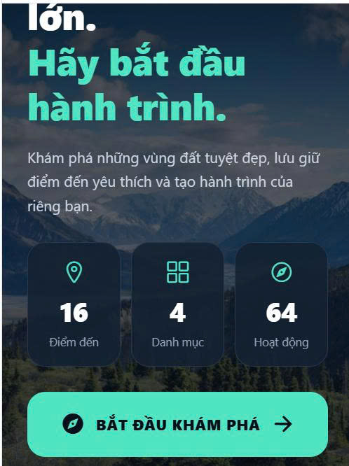
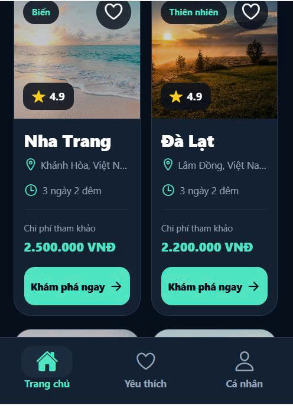
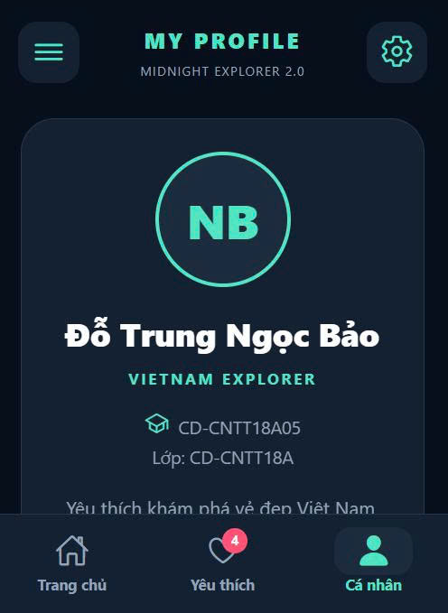
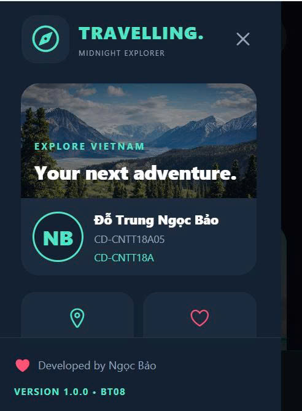
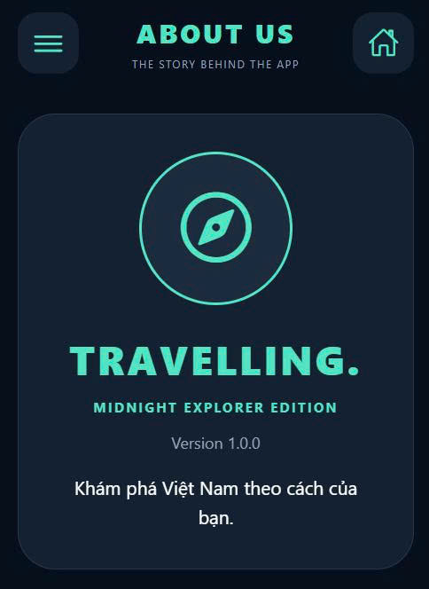
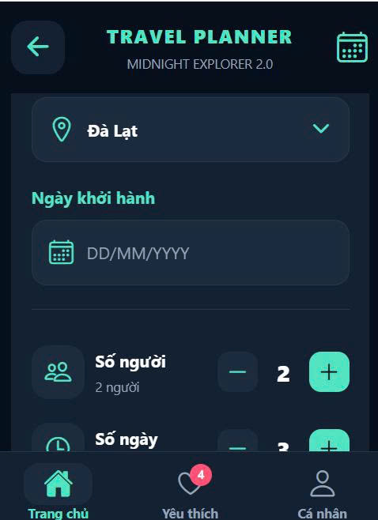
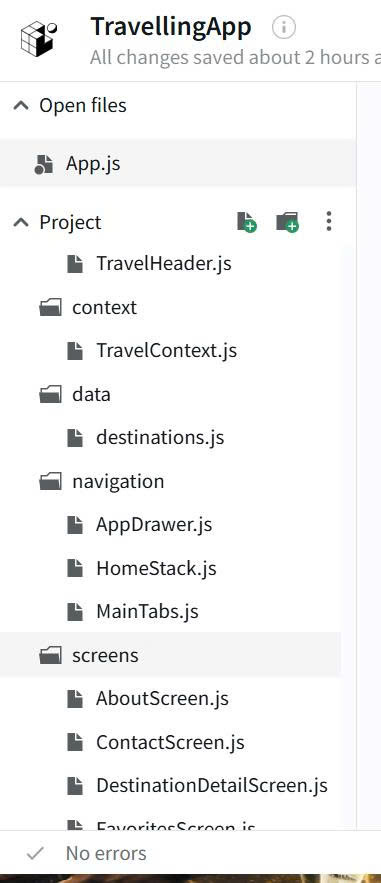

# 🌍 BÀI TẬP 8 – TRAVELLING APP

## 👨‍🎓 Thông tin sinh viên

- Họ và tên: Đỗ Trung Ngọc Bảo
- Mã sinh viên: CD-CNTT18A05
- Lớp: CD-CNTT18A
- Môn học: React Native
- Bài 2 – Bài tập 08
- Tên ứng dụng: TravellingApp

## 🚀 Link chạy ứng dụng

[Trải nghiệm TravellingApp trên Expo Snack](https://snack.expo.dev/@dotrungngocbao/travellingapp)

## 🌴 Giới thiệu ứng dụng

TravellingApp là ứng dụng khám phá địa điểm du lịch Việt Nam, được thiết kế theo phong cách Midnight Explorer với giao diện hiện đại, tông màu xanh đen kết hợp xanh ngọc.

## ✨ Chức năng ứng dụng

- Banner du lịch nổi bật.
- Khám phá 16 địa điểm du lịch.
- Tìm kiếm và lọc địa điểm theo danh mục.
- Xem thông tin chi tiết địa điểm.
- Thêm và xóa địa điểm yêu thích.
- Quản lý thông tin cá nhân.
- Lập kế hoạch du lịch giả lập.
- Chuyển đổi giao diện sáng và tối.
- Lưu dữ liệu bằng AsyncStorage.
- Giới thiệu, cài đặt và liên hệ.

## 🛠️ Công nghệ sử dụng

- React Native
- Expo Snack
- JavaScript
- React Navigation
- Tab Navigation
- Drawer Navigation
- Stack Navigation
- FlatList
- Flexbox
- AsyncStorage
- Context API
- Expo Vector Icons

## 🧩 Các Component chính

| Component | Chức năng |
|---|---|
| TravelHeader | Hiển thị tiêu đề và điều hướng |
| DestinationCard | Hiển thị địa điểm du lịch |
| CategoryList | Hiển thị danh mục du lịch |
| FavoriteCard | Hiển thị địa điểm yêu thích |
| ProfileInfo | Hiển thị thông tin cá nhân |

## 📂 Cấu trúc mã nguồn

    travellingapp/
    ├── App.js
    ├── package.json
    ├── components/
    ├── screens/
    ├── navigation/
    ├── context/
    ├── data/
    └── assets/

## 📸 Hình ảnh minh chứng

## 📸 Hình ảnh minh chứng

### 1. Màn hình chào mừng

### 2. Trang chủ

### 3. Chi tiết địa điểm

### 4. Danh sách yêu thích

### 5. Trang cá nhân

### 6. Drawer Navigation

### 7. Giới thiệu

### 8. Cài đặt

### 9. Liên hệ

### 10. Lập kế hoạch du lịch

### 11. Cấu trúc Component

## 📝 Kết luận

Ứng dụng được xây dựng nhằm thực hành tổ chức Component, thiết kế giao diện và kết hợp Tab Navigation, Drawer Navigation, Stack Navigation trong React Native.

Thông tin du lịch, chi phí và chức năng liên hệ mang tính minh họa phục vụ học tập.

---

© 2026 Đỗ Trung Ngọc Bảo – TravellingApp
